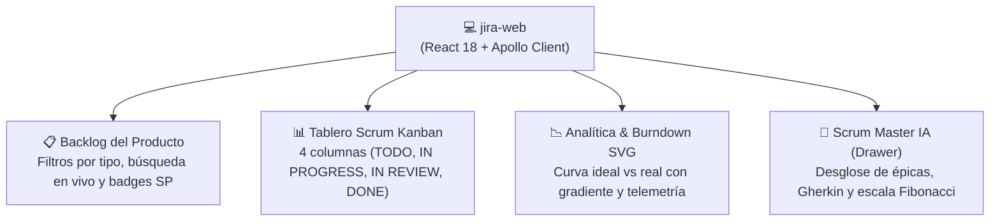

# 💻 Frontend Web SPA (`jira-web`)

[]()
[]()
[]()
[]()
[]()
[]()

Frontend web de página única (**SPA**) para la plataforma **Jira AI**. Desarrollado con **React 18**, **Vite** y **TypeScript**, consume el API Gateway GraphQL de `jira-bff` mediante **Apollo Client** y sigue un diseño estético riguroso **Data-Dense / Dev-Tool (estilo Linear / Raycast)** respetando las directrices de `frontend-craft` (sin gradientes morados genéricos ni sombras difusas).

---

## 🏛️ Vistas y Capacidades Principales



### Funcionalidades Destacadas
1. **Backlog del Producto:** Vista tabular densa sincronizada con MS1 (Go + PostgreSQL), filtros instantáneos por tipo de incidencia (Historia, Bug, Tarea, Épica) y cálculo de Story Points totales.
2. **Tablero Scrum Activo:** Tablero Kanban con cuatro columnas de flujo de valor y acción de avance rápido de estado entre fases.
3. **Métricas de Sprint & Burndown:** Gráfico SVG de curva de burndown interactivo con gradiente de área, nodos con micro-anillos, KPIs de salud de sprint y telemetría del clúster de microservicios en tiempo real.
4. **Scrum Master IA Drawer:** Cajón interactivo conectado al servidor MCP para desglosar requerimientos funcionales en historias de usuario con criterios de aceptación en formato *Gherkin (Given/When/Then)* y estimación Fibonacci.
5. **Modal de Creación con Chips Fibonacci:** Formulario asistido con selección rápida de puntos de historia (`1`, `2`, `3`, `5`, `8`, `13`).
6. **Cobertura Completa de 4 Estados:** Skeletons proporcionales para carga, estados vacíos con ilustración asistida, y diagnóstico de fallos con reintento.

---

## 📂 Estructura del Proyecto

```text
jira-web/
├── src/
│   ├── components/              # Componentes de interfaz reutilizables
│   │   ├── AIAssistantDrawer.tsx # Panel lateral del Scrum Master MCP
│   │   ├── CreateIssueModal.tsx  # Modal con selector rápido Fibonacci
│   │   └── Navbar.tsx            # Navegación y telemetría de clúster
│   ├── graphql/                 # Configuración Apollo Client y operaciones
│   │   └── client.ts            # Queries y Mutations GraphQL (/graphql)
│   ├── pages/                   # Vistas principales del sistema
│   │   ├── AnalyticsPage.tsx    # Gráfico SVG de Burndown y KPIs
│   │   ├── BacklogPage.tsx      # Tabla de backlog con filtros
│   │   └── BoardPage.tsx        # Tablero Scrum Kanban de 4 columnas
│   ├── App.tsx                  # Enrutamiento de pestañas y estado global
│   ├── index.css                # Sistema de tokens Data-Dense Zinc 950
│   └── main.tsx                 # Montaje en el DOM
├── tests/                       # Suite de pruebas automatizadas
│   ├── app.spec.tsx             # Integración global y cambio de pestañas
│   ├── components.spec.tsx      # Pruebas de componentes y modales
│   ├── pages.spec.tsx           # Pruebas de páginas, filtros y SVG
│   └── setup.ts
├── dist/                        # Bundle de producción optimizado por Vite
├── nginx.conf                   # Configuración del servidor Nginx para Docker
├── Dockerfile                   # Multi-stage build (Node build -> Nginx Alpine)
├── package.json
└── vite.config.ts
```

---

## ⚙️ Variables de Entorno

| Variable | Descripción | Valor por Defecto |
| :--- | :--- | :--- |
| `VITE_GRAPHQL_URL` | URL del endpoint GraphQL del BFF | `http://localhost:4000/graphql` |
| `PORT` | Puerto de escucha en Nginx (Docker) | `80` (mapeado a `:5173` o `:80`) |

---

## 🧪 Pruebas Automatizadas y Cobertura

La suite de pruebas fue desarrollada con **Jest** y **React Testing Library**:

```bash
# Instalar dependencias
npm install

# Ejecutar pruebas unitarias y de componentes con reporte de cobertura
npm test

# Compilar para producción (TypeScript + Vite)
npm run build
```

### Métrica de Cobertura Verificada
* **Statements:** **92.62%**
* **Branches:** **79.83%**
* **Functions:** **84.05%**
* **Lines:** **93.93%**
* **Total de Pruebas:** 19/19 tests pasando al 100%.

---

## 🐳 Despliegue con Docker

El proyecto se empaqueta en una imagen liviana de **Nginx Alpine** que sirve los archivos estáticos pre-compilados:

```bash
# Compilar la imagen Docker
docker build -t jira-ai-web-frontend .

# Ejecutar el contenedor
docker run -d -p 5173:80 -p 80:80 jira-ai-web-frontend
```

La aplicación queda accesible de inmediato en [http://localhost:5173](http://localhost:5173) o [http://localhost:80](http://localhost:80).

---

## 📄 Licencia

MIT License © 2026 Jira AI Team.
